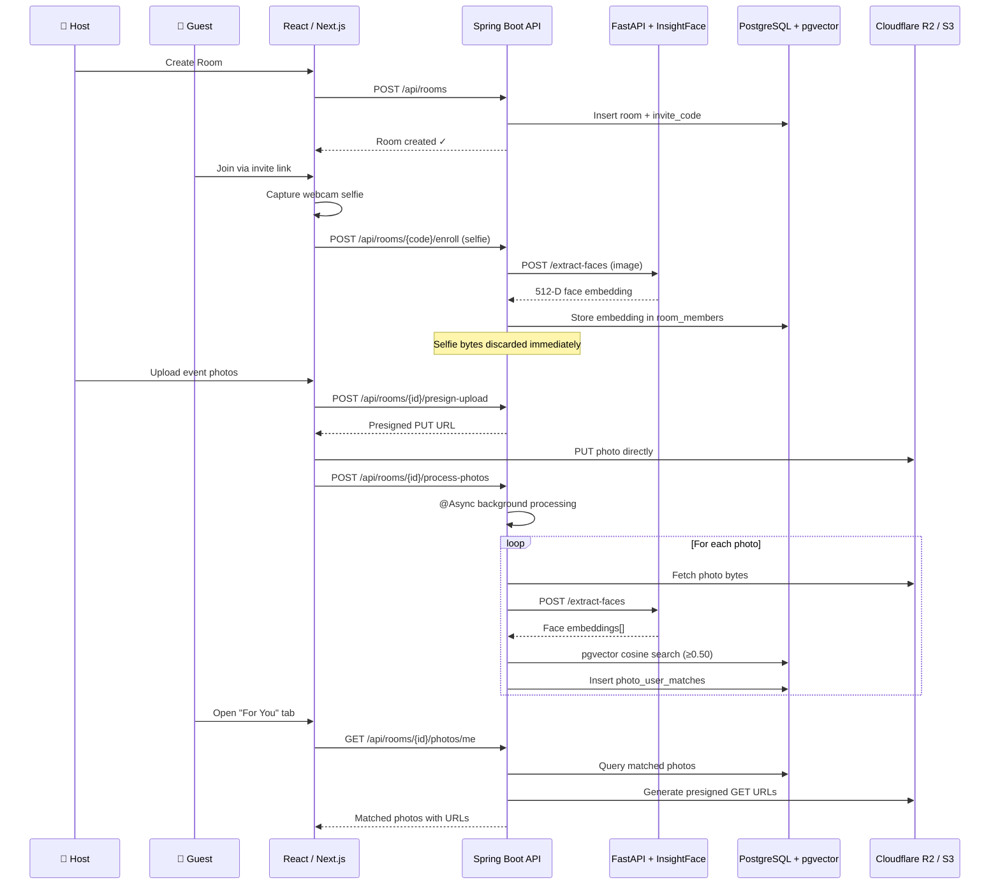

<p align="center">
  <h1 align="center">📸 SnapRoom</h1>
  <p align="center">
    <strong>Find your face in the crowd — instantly.</strong>
    <br />
    AI-powered facial routing that delivers <em>your</em> photos from any event, party, or gathering.
  </p>
  <p align="center">
    <a href="#-how-it-works">How It Works</a> · <a href="#-quick-start">Quick Start</a> · <a href="#-api-reference">API</a> · <a href="#-contributing">Contributing</a>
  </p>
</p>

---

## 🎯 What is SnapRoom?

Ever been to a wedding, party, or team outing and spent hours scrolling through hundreds of photos to find the ones with *you* in them? **SnapRoom solves this.**

A host creates a **Room**, shares an invite link or QR code, and guests enroll with a quick webcam selfie. When event photos are uploaded, SnapRoom's AI automatically detects faces, matches them to enrolled members using 512-dimensional facial embeddings, and delivers a personalised **"For You"** gallery to each participant — no manual tagging, no searching.

### ✨ Key Features

| Feature | Description |
|---|---|
| **Rooms & Invite Codes** | Create event rooms and invite guests via shareable link or QR code |
| **Webcam Face Enrollment** | One-click selfie enrollment — raw images are discarded immediately after vector extraction |
| **Direct-to-Cloud Upload** | Photos upload directly to S3-compatible storage via presigned URLs (zero backend bottleneck) |
| **AI Face Matching** | InsightFace `buffalo_l` extracts 512-D ArcFace embeddings; pgvector cosine similarity matches faces at ≥ 0.50 threshold |
| **"For You" Gallery** | Each member sees only photos containing their face, alongside an "All Photos" view |
| **Bulk ZIP Download** | Stream-download selected photos or your entire matched gallery as a `.zip` archive |
| **Privacy-First Design** | Enrollment selfies are never stored — only the numerical embedding vector is kept |

---

## 🧠 How It Works



### The Flow in Plain English

1. **Create a Room** — The host creates an event room and gets a unique invite code
2. **Enroll Your Face** — Each guest takes a quick webcam selfie; the AI extracts a 512-dimensional face vector, and the raw selfie is immediately discarded
3. **Upload Photos** — The host uploads event photos directly to cloud storage via presigned URLs
4. **AI Sorts the Photos** — A background worker sends each photo to the InsightFace model, extracts all face embeddings, and runs a cosine similarity search against enrolled members using pgvector
5. **Get Your Photos** — Each guest opens their **"For You"** tab to see only photos containing their face, and can bulk-download them as a ZIP

---

## 🏗️ Architecture

SnapRoom is a monorepo with four core services:

```
snaproom/
├── frontend/        → Next.js / React + TypeScript UI           (Port 3000)
├── backend/         → Java 21 + Spring Boot 3.x Core API        (Port 8080)
├── ai-services/     → Python 3.11 + FastAPI + InsightFace        (Port 8001)
├── db/              → PostgreSQL 16 + pgvector migrations        (Port 5433)
├── infra/           → Docker Compose, deploy scripts, CORS config
├── docs/            → Architecture docs, API spec, setup guides
├── .env.example     → Environment variable template
└── README.md
```

### Tech Stack

| Layer | Technology |
|---|---|
| **Frontend** | React 18 + Next.js (App Router), TypeScript, Tailwind CSS, Lucide Icons |
| **Backend API** | Java 21, Spring Boot 3.x, Spring Security (JWT), Spring Data JPA, Hibernate Vector |
| **AI Service** | Python 3.11, FastAPI, InsightFace (`buffalo_l`), ONNX Runtime (CPU), OpenCV |
| **Database** | PostgreSQL 16, pgvector extension, 512-D vector columns |
| **Object Storage** | Cloudflare R2 / AWS S3 / MinIO (S3-compatible) |
| **Infrastructure** | Docker Compose, Uvicorn, Maven |

### Database Schema

```
┌──────────┐       ┌──────────────┐       ┌──────────┐
│  users   │──1:N──│ room_members │──N:1──│  rooms   │
│          │       │  embedding   │       │invite_code│
└──────────┘       │  vector(512) │       └──────────┘
     │             └──────────────┘            │
     │                                         │
     │             ┌──────────┐                │
     └────────────│  photos   │───────────────┘
                   │object_key │
                   │  status   │
                   └──────────┘
                        │
                  ┌─────────────────┐
                  │photo_user_matches│
                  │similarity_score  │
                  └─────────────────┘
```

**Core tables:** `users`, `rooms`, `room_members` (with `vector(512)` embedding column), `photos`, `photo_user_matches`

---

## 🚀 Quick Start

### Prerequisites

- **Docker & Docker Compose v2** — for the database, AI service, and backend
- **Java 21** — for the Spring Boot backend (if running outside Docker)
- **Node.js 20+** — for the Next.js frontend
- **Python 3.11** — for the AI service (if running outside Docker)

### 1. Clone & Configure

```bash
git clone https://github.com/SatyamMhetre741/SnapRoom.git
cd snaproom

# Copy and edit the environment file
cp .env.example .env
# Edit .env with your database credentials, JWT secret, and storage keys
```

### 2. Start the Infrastructure

```bash
# Start PostgreSQL (pgvector), AI service, and Spring Boot backend
docker compose -f infra/docker-compose.yml up -d --build
```

This starts:
| Service | URL | Description |
|---|---|---|
| PostgreSQL | `localhost:5433` | Database with pgvector extension |
| AI Service | `localhost:8001` | InsightFace face extraction API |
| Spring Boot | `localhost:8080` | Core REST API |

### 3. Start the Frontend

```bash
cd frontend
npm install
npm run dev
```

The frontend will be available at **http://localhost:3000**

### 4. Configure Object Storage

SnapRoom uses S3-compatible object storage for photos. Set up one of:

- **Cloudflare R2** (recommended for production — $0.00/GB egress)
- **AWS S3**
- **MinIO** (local development)

Apply the CORS policy from `infra/storage/cors-policy.json` to your bucket to allow presigned uploads from the browser. See `infra/storage/r2-setup.md` for step-by-step R2 setup.

### Environment Variables

| Variable | Description |
|---|---|
| `POSTGRES_HOST` / `PORT` / `DB` / `USER` / `PASSWORD` | PostgreSQL connection |
| `SPRING_DATASOURCE_URL` / `USERNAME` / `PASSWORD` | Spring Boot datasource |
| `JWT_SECRET` | 256-bit secret key for signing JWT tokens |
| `AI_SERVICE_URL` | URL to the FastAPI AI service (default: `http://localhost:8001`) |
| `STORAGE_ENDPOINT` | S3/R2 endpoint URL |
| `STORAGE_REGION` | Storage region (use `auto` for R2) |
| `STORAGE_BUCKET_NAME` | Bucket name (default: `snaproom-photos`) |
| `AWS_ACCESS_KEY_ID` / `SECRET_ACCESS_KEY` | S3-compatible API credentials |
| `NEXT_PUBLIC_API_BASE_URL` | Frontend → Backend API base URL |

---

## 📡 API Reference

### Authentication

| Method | Endpoint | Description |
|---|---|---|
| `POST` | `/api/auth/register` | Register a new user |
| `POST` | `/api/auth/login` | Login and receive JWT token |

### Rooms

| Method | Endpoint | Description |
|---|---|---|
| `POST` | `/api/rooms` | Create a new room (caller becomes `LEADER`) |
| `POST` | `/api/rooms/{inviteCode}/enroll` | Join a room with webcam selfie enrollment |

### Photos

| Method | Endpoint | Description |
|---|---|---|
| `POST` | `/api/rooms/{roomId}/presign-upload` | Get a presigned PUT URL for direct photo upload |
| `POST` | `/api/rooms/{roomId}/process-photos` | Trigger async face matching (returns `202 Accepted`) |
| `GET` | `/api/rooms/{roomId}/photos/me` | Get photos matched to the authenticated user |
| `GET` | `/api/rooms/{roomId}/photos` | Get all photos in the room |
| `POST` | `/api/rooms/{roomId}/download-zip` | Stream-download selected photos as a ZIP archive |

### AI Service (Internal)

| Method | Endpoint | Description |
|---|---|---|
| `GET` | `/health` | Health check |
| `POST` | `/extract-faces` | Extract face embeddings from an uploaded image |

> **Note:** The AI service is internal-only and should never be exposed publicly in production.

---

## 🔒 Privacy & Security

- **Enrollment selfies are never stored.** Only the 512-dimensional numerical embedding vector is persisted — the raw image bytes are discarded immediately after extraction.
- **JWT-based authentication** secures all API endpoints.
- **Presigned URLs** ensure photos are uploaded directly to cloud storage without passing through the application server.
- **The AI service has no authentication layer** and must only be reachable by the backend over the internal Docker network — never exposed to the public internet.
- **Room-scoped data isolation** — face matching is performed only within the context of a single room.

---

## 🧪 Development

### Running Tests

```bash
# Backend (JUnit 5 + MockMvc)
cd backend/SnapRoom/SnapRoom
./mvnw test

# AI Service (pytest)
cd ai-services
pip install -r requirements.txt
pytest
```

### Production Deployment

```bash
# Deploy with production overrides (removes public port bindings for DB & AI)
docker compose -f infra/docker-compose.yml -f infra/docker-compose.prod.yml up -d --build
```

Or use the deploy script:
```bash
bash infra/deployment/deploy.sh
```

**Recommended production setup:**
- Backend + AI + Postgres on a **4 GB RAM Linux VPS** (Hetzner, DigitalOcean, Render)
- Frontend on **Vercel**
- Photo storage on **Cloudflare R2**

---

## 🤝 Contributing

Contributions are welcome! Here's how to get started:

1. **Fork** the repository
2. **Create a feature branch** (`git checkout -b feature/amazing-feature`)
3. **Commit your changes** (`git commit -m 'Add amazing feature'`)
4. **Push to the branch** (`git push origin feature/amazing-feature`)
5. **Open a Pull Request**

Please make sure to update the relevant documentation in `docs/` if you modify database tables, REST endpoints, or environment variables.

---

## 📄 License

This project is licensed under the **Apache License 2.0** — see the [LICENSE](LICENSE) file for details.

---

<p align="center">
  Built with ❤️ using Spring Boot, FastAPI, InsightFace, pgvector, and Next.js
</p>
